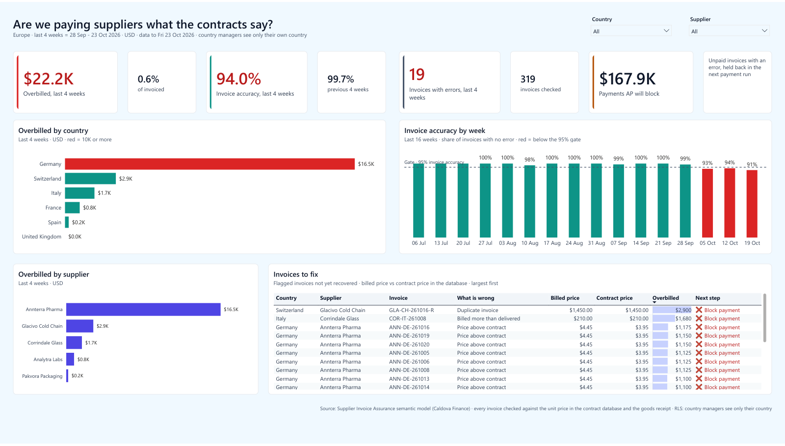
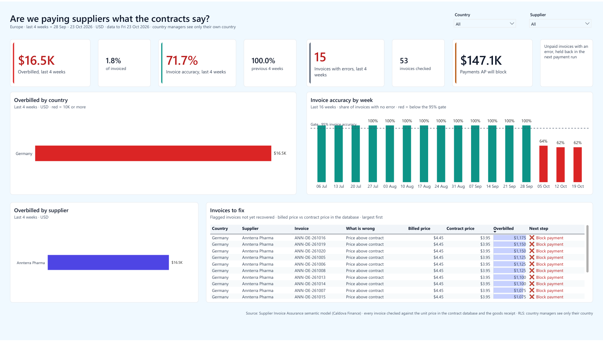
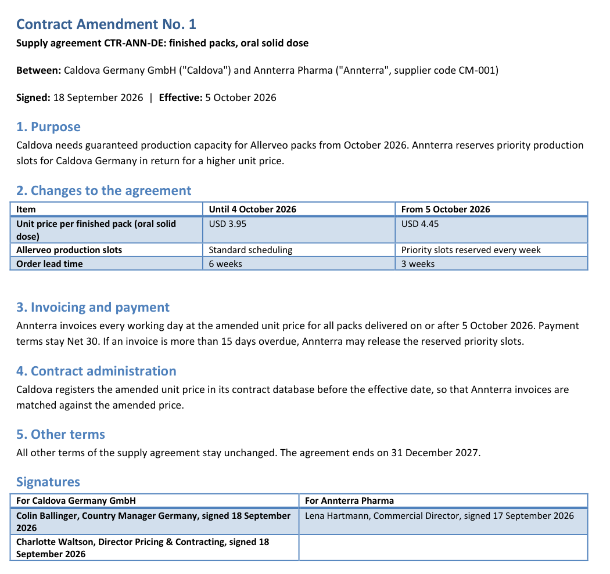

# Fabric IQ in Microsoft 365 Copilot and Cowork: "Should we hold Annterra payments?"

A 25-minute demo of **conversational analytics with Fabric IQ** in **Microsoft 365 Copilot Chat** and **Copilot Cowork**, on one governed Power BI semantic model and report, enriched with emails and files (**Work IQ**). This README is the whole runbook: the story, the setup, the exact prompts and what to say.

1. [The problem](#the-problem)
2. [The demo at a glance](#the-demo-at-a-glance)
3. [Set up](#set-up)
4. [Run the demo](#run-the-demo-25-minutes)
5. [If something goes wrong](#if-something-goes-wrong)
6. [The numbers on screen](#the-numbers-on-screen)
7. [What's in the repo](#whats-in-the-repo)

## The problem

Caldova is a fictional pharma company. It makes its medicine, Allerveo, in its own plant and pays **Annterra Pharma** to pack the tablets for the German market, per finished pack.

- **The change.** On 18 September, Charlotte, Director of Pricing & Contracting, signed Contract Amendment No. 1: **$4.45 per pack instead of $3.95, from 5 October**. She told Colin, Country Manager Germany, and sent the price update to the team mailbox that maintains the contract data.
- **The gap.** That mailbox had been closed on 15 September. Nobody registered the new price, so the contract data still says **$3.95**.
- **What the report shows.** Since 5 October all **15 Annterra invoices in Germany** are flagged *price above contract*:
  - Germany's invoice accuracy fell from 100% to 71.7%;
  - $16,525 is flagged as overbilled;
  - Accounts Payable will block **$147,073** of payments, due from 4 November.

  Isaac, Region Manager Europe, is about to tell Accounts Payable to hold them.
- **Why that's hard.** The data alone says "block". The reason it's wrong is outside the data: in a signed document and two emails. Usually it takes a chain of questions and meetings to find it, and meanwhile a supplier that billed correctly gets paid late.

**The report, as Isaac sees it** (all 6 countries): Europe at 94.0%, Germany the only red bar.



**The same report, as Colin sees it** (row-level security, Germany only): 71.7%, three red weeks from 5 October, all Annterra at $4.45 against $3.95 in the contract data, $147.1K to block.



**The signed amendment** ([seed-content](seed-content), uploaded to Colin's OneDrive). The report knows nothing about it:



## The demo at a glance


**The message:** Fabric IQ shows *what*, Work IQ finds *why*, Cowork does the work, and everyone sees only the data they're allowed to see.

Both Copilots query Power BI as the signed-in user. Copilot Chat "uses the user's existing permissions, including row-level security (RLS) and object-level security (OLS), to access the data" ([Fabric IQ in Microsoft 365 Copilot](https://learn.microsoft.com/fabric/iq/connectors/microsoft-365-copilot-overview)). In Cowork, "queries run against Power BI as you, so existing item permissions and row-level security (RLS) continue to apply" ([Fabric IQ plugin in Copilot Cowork](https://learn.microsoft.com/fabric/iq/connectors/cowork-overview)).

### Who is who

| Person (sign-in) | Role | Sees in the data | In the demo |
|---|---|---|---|
| **Isaac Fielder** (IsaacF) | Region Manager Europe | All 6 countries | Power BI report and Copilot Chat; gets Colin's email and the meeting invite |
| **Colin Ballinger** (ColinB) | Country Manager Germany | **Only Germany** (RLS) | Copilot Chat and Copilot Cowork |
| **Charlotte Waltson** (CharlotteW) | Director, Pricing & Contracting; signed the amendment | Not used | Sends one seed email; cc on Colin's email to Laurence |
| **Laurence Gilbertson** (LaurenceG) | Data Analyst, registers contract prices | All countries | Gets Colin's email and the meeting invite |

## Set up

You need a Microsoft 365 tenant with Microsoft 365 Copilot licenses for Isaac and Colin, Copilot Cowork for Colin, a Microsoft Fabric capacity, and the four personas as user accounts. On your machine: Python 3.11, PowerShell 7 and the Azure CLI.

### Step 1: Deploy (once, 20 minutes)

```powershell
# 1. Your tenant: copy the example and fill in tenant ID, domain, subscription, capacity and aliases (config/tenant.json is git-ignored)
Copy-Item config/tenant.example.json config/tenant.json
# 2. Python environment
py -3.11 -m venv .venv; .\.venv\Scripts\pip install -r requirements.txt
# 3. Sign in with a repo-local Azure CLI profile (your default profile stays untouched)
pwsh -File scripts/Connect-Caldova.ps1
pwsh -File scripts/Test-TenantIsolation.ps1
# 4. Deploy: workspaces, lakehouse, data, model, permissions, report, DAX checks
pwsh -File scripts/Deploy-CaldovaFinance.ps1
```

The deploy creates the workspaces *Caldova Finance* (lakehouse, data, semantic model) and *Caldova Finance Insights* (report), loads the synthetic data and checks the numbers with DAX. Then add **ColinB** to the **Business User** role of the model in the Power BI service (model > **Security**). Scripts never add role members.

The result:

- Colin is a Viewer on *Caldova Finance Insights* and in the *Business User* role, so he sees only Germany.
- Isaac is an Admin on both workspaces, so he sees every country: "RLS only restricts data access for users with **Viewer** permissions." ([Row-level security](https://learn.microsoft.com/fabric/security/service-admin-row-level-security))
- Laurence is a Contributor on *Caldova Finance*.

The sign-in uses a separate Azure CLI configuration folder (`AZURE_CONFIG_DIR`) inside the repo, so it never mixes with your usual account ([Azure CLI tips](https://learn.microsoft.com/cli/azure/use-azure-cli-successfully-tips)). The scripts also check the tenant ID of every token before they call Fabric.

**Start the capacity before every session.** Copilot can't read the report while the Fabric capacity is paused. In the Azure portal, open your Fabric capacity, select **Resume** and **Yes**. Resuming restarts billing, so select **Pause** when you're done. ([Pause and resume your Fabric capacity](https://learn.microsoft.com/fabric/enterprise/pause-resume))

### Step 2: Prep the model for Copilot (once, 15 minutes)

Without this, Copilot can mix up the $16.5K flagged with the $147K AP will block, or read "last 4 weeks" as the calendar month. "Fabric IQ uses the measures, relationships, and business definitions in your semantic model to answer questions", and Prep data for AI adds the context it can't infer ([Ask data questions with Copilot and Fabric IQ](https://learn.microsoft.com/power-bi/create-reports/copilot-ask-data-question)). Prep data for AI is in preview.

Sign in to Power BI as an Admin of *Caldova Finance*, open the semantic model **Supplier Invoice Assurance** and select **Prep data for AI** on the ribbon. If the tabs are greyed out, select **Turn on Q&A**.

**a. Add AI instructions.** On the **Add AI instructions** tab, paste this text and select **Apply**:

```text
Business context
Caldova Pharma checks every supplier invoice line against the unit price in the contract data and the goods receipt, for six European affiliates: Germany, France, Italy, Spain, United Kingdom and Switzerland. This model answers: are we paying suppliers what the contracts say, where and since when are invoices flagged, which suppliers and invoices are affected, and what Accounts Payable will block.

Time
- Invoice data runs to Friday 23 October 2026. Later weeks in the Date table have no invoices; ignore them.
- "Recently", "lately", "the last few weeks" and "the last 4 weeks" mean 28 Sep to 23 Oct 2026, which is Date[Weeks Ago] 0 to 3.
- "The 4 weeks before" means 31 Aug to 27 Sep 2026 (Date[Weeks Ago] 4 to 7). For the comparison use [Invoice Accuracy % Previous 4 Weeks].
- Show trends by Date[Week] (each week is labelled by its Monday, for example "05 Oct") for the last 8 weeks (Date[Weeks Ago] 0 to 7) or 16 weeks (0 to 15). Use months or quarters only when the user asks for them.

Terminology and metric routing
- Overbilled, overcharged, leakage or flagged amount = [Overbilled Amount]. As a share of the invoiced amount = [Overbilling %].
- Invoice accuracy = [Invoice Accuracy %]: the share of invoices with no error, counted by invoice, not by value.
- Flagged or wrong invoices = [Invoices with Errors]. Invoices checked = [Invoices].
- What Accounts Payable (AP) will block, payments on hold or payments at risk = [Payments to Block] (full value of unpaid invoices with an error) and [Invoices to Block]. Use only these two measures for this question.
- Contract price = 'Invoice Lines'[Contract Unit Price], the price in the contract data. Billed price = 'Invoice Lines'[Billed Unit Price]. When the contract price was last updated = Contracts[Price Last Updated].
- Error types are in 'Error Types'[Error Type]: Price above contract, Duplicate invoice, Billed more than delivered. "No error" means the invoice line is correct.
- Country = market = affiliate = Countries[Country]. All six countries are in Countries[Region] "Europe". Supplier = Suppliers[Supplier Name].

How to answer
- Lead with one sentence, then a compact table or visual. Always state the period (for example "last 4 weeks, 28 Sep - 23 Oct 2026") and show amounts in USD.
- "Which supplier drives it": [Overbilled Amount] by Suppliers[Supplier Name] and 'Error Types'[Error Type]. For price above contract, also show the billed price, the contract price and Contracts[Price Last Updated].
- "Which invoices": Invoice Number, Invoice Date, Country, Supplier Name, Error Type, Billed Unit Price, Contract Unit Price, Overbilled Amount and Next Step, sorted by Invoice Date.
- Higher invoice accuracy is better; 95% is the gate, and weeks below it need attention. Lower overbilling is better.
- The model shows whether invoices match the contract data, not why a price differs. If asked why, show the billed price, the contract price and when the contract price was last updated, and don't guess reasons.
- Answers follow each user's row-level security. If fewer countries appear than the user expects, say that the results reflect their data access, and never guess other countries.
```

**b. Simplify the data schema.** On the **Simplify data schema** tab, hidden fields are already cleared ([AI data schemas](https://learn.microsoft.com/power-bi/create-reports/copilot-prepare-data-ai-data-schema)). Also clear these four, then select **Apply**:

| Table | Clear | Why |
|---|---|---|
| Invoice Lines | Overbilled Not Yet Paid | Sounds like "what AP will block", but it's only the overbilled part ($16.5K), not what AP holds ($147K) |
| Invoice Lines | Amount at Risk | Same risk: also $16.5K for Germany |
| Invoice Lines | Recovered Amount | Not part of this story |
| Date | Month Start | Duplicates *Year Month* |

**c. Skip verified answers.** "Row-level security (RLS) and object-level security (OLS) aren't fully supported as security features for verified answers", and Colin's view depends on RLS. Also, "if a match is found, Copilot returns the verified answer instead of generating a new response", which would cut the multi-part prompts short. ([Verified answers](https://learn.microsoft.com/power-bi/create-reports/copilot-prepare-data-ai-verified-answers))

**d. Approve for Copilot.** On the model, select **...** > **Settings**, expand **Approved for Copilot**, select the box and **Apply**. Otherwise "models that aren't approved for Copilot appear with warnings that the answer quality could be low" ([Standalone Copilot](https://learn.microsoft.com/power-bi/explore-reports/copilot-chat-with-data-standalone)). In the same settings, leave "Allow any person with only read permissions to use AI" **on** (the default). If it's off, Colin can't use Copilot on this model ([Copilot with semantic models](https://learn.microsoft.com/power-bi/create-reports/copilot-semantic-models)).

Don't run `Deploy-CaldovaFinance.ps1 -Step model -UpdateModel` after this. It stops on purpose so it can't overwrite these settings; `-Step load,refresh,validate` is fine.

### Step 3: Seed Colin's OneDrive and mailbox (the day before, 20 minutes)

Copilot can only find the *why* if it's in Colin's emails and files. Seed at least a day before the demo so Copilot can index them, but no more than two weeks before, because the Monday briefing looks back two weeks. Send each email from Outlook on the web, signed in as the sender, and paste the texts as plain text (**Ctrl+Shift+V**). If you can't sign in as Charlotte, send her email from an admin account.

**S1. The signed amendment (file).** As ColinB, in OneDrive **My files**, create a folder **Contracts** and upload `seed-content/Annterra Pharma - Caldova Germany - Contract Amendment No 1.docx`.

**S2. Charlotte to Colin, with the same amendment file attached.** Subject: **FW: Annterra Amendment No. 1 - please register the new price in the contract database**

```text
Hi Colin,

As discussed, here is the fully signed Amendment No. 1 with Annterra for your files. My registration request from September is below.

Best regards,
Charlotte

From: Charlotte Waltson
Sent: Monday, 21 September 2026 09:40
To: Contract Admin team mailbox
Cc: Colin Ballinger
Subject: Annterra Amendment No. 1 - please register the new price in the contract database

Hello Contract Admin team,

Please register Amendment No. 1 to the Annterra Pharma supply agreement for Caldova Germany (contract CTR-ANN-DE) in the contract database. The amended pack price applies to all deliveries from 5 October 2026, so it needs to be in the database before the first October invoices arrive. The signed amendment is attached.

Thank you,
Charlotte Waltson
Director, Pricing & Contracting
```

**S3. Finance Shared Services to Colin and Charlotte** (from an admin account). Subject: **Reminder: contract-admin mailbox closed on 15 September - send contract price changes to Laurence Gilbertson**

```text
Dear colleagues,

A reminder: contract administration for the European affiliates moved to the Europe finance shared-service center in September. As part of this move, the contract-admin mailbox was closed on 15 September 2026. Messages sent to it after that date were not forwarded and were not processed.

From now on, send contract price changes directly to Laurence Gilbertson, Data Analyst, with the signed contract document attached. Laurence registers the price in the contract data and refreshes the Supplier Invoice Assurance model, so every report and Copilot answer uses it.

If you sent a contract change to the contract-admin mailbox after 15 September, please send it again to Laurence.

Kind regards,
Finance Shared Services Europe
```

### Step 4: Check the seed and Cowork (a few hours later, 10 minutes)

As Colin, in Copilot at copilot.cloud.microsoft (**Chat**), ask: *What do my emails and files say about Annterra's contract price for Caldova Germany, and who registers contract prices now?* Expect the amendment ($4.45 from 5 Oct), Charlotte's request to the contract-admin mailbox (21 Sep) and the reminder that Laurence now registers prices. If Copilot finds nothing, wait a few hours and ask again.

Then select **Cowork** in the top toggle and **Customize** in the left navigation ([Customize Cowork](https://learn.microsoft.com/microsoft-365/copilot/cowork/cowork-customize)):

- **Plugins:** **Fabric IQ** is listed under **Installed** and turned on. It's the plugin that reads Power BI reports and is "installed by default in Cowork".
- **Skills:** the built-in list includes **PowerPoint**, **Email** and **Scheduling**, the skills prompt 5 needs.

### Step 5: Rehearse once (30 minutes)

Run the whole demo once. Then, in Colin's Copilot Chat, delete the Monday briefing under **... Settings and more** > **Scheduled prompts**, but keep the Cowork task as a backup. On the demo morning, delete the rehearsal email and meeting in Isaac's and Laurence's mailboxes.

## Run the demo (25 minutes)

**15 minutes before:**

- **Capacity:** running.
- **Isaac's browser profile:** the *Supplier Invoice Assurance* report, Copilot at copilot.cloud.microsoft (**Chat**) and Outlook.
- **Colin's browser profile:** the report and Copilot, then **Cowork** "in the top toggle next to Chat" ([Get started with Cowork](https://learn.microsoft.com/microsoft-365/copilot/cowork/get-started)). Open the rehearsal task as a backup.
- **Laurence's browser profile:** Outlook.
- Keep the report link at hand.

| Prompt | What Copilot uses | Where you see it |
|---|---|---|
| 1–3 · Isaac asks | Copilot Chat with Fabric IQ (the report, as Isaac) | Answers with numbers and charts; a draft email |
| 4 · Colin investigates | Fabric IQ (the report, as Colin) and a search of his emails and files (Work IQ) | Short updates such as *Searching OneDrive* |
| 5 · Do the work | Cowork skills **PowerPoint**, **Email** and **Scheduling** ([Use Cowork](https://learn.microsoft.com/microsoft-365/copilot/cowork/use-cowork#cowork-skills)) | The deck under **Output folder**; the drafts in the approval cards |
| 6 · Keep watching | A scheduled prompt in Copilot Chat | **... Settings and more** > **Scheduled prompts** |

### 1 · Isaac · Power BI report, then Copilot Chat (3 minutes)

Show the report first, then ask Copilot Chat:

```text
Give me a brief executive summary of the Supplier Invoice Assurance Power BI report with visuals. How did supplier invoice accuracy and overbilling develop in the last 4 weeks compared with the 4 weeks before? Flag anything out of step.
```

- **You'll see:** Europe 94.0% (was 99.7%), $22.2K flagged; the drop starts in the week of 5 Oct.
- **Say:** "Isaac runs six countries. One question, and Copilot reads the governed Power BI report for him."

### 2 · Isaac · Copilot Chat (2 minutes)

```text
Break it down by country and by week, and tell me which supplier drives it and what AP will block.
```

- **You'll see:** Germany $16.5K, all Annterra: $4.45 billed against $3.95 in the contract data since 5 Oct. AP will block $147K.
- **Say:** "Annterra packs our tablets, and we pay per finished pack. Since 5 Oct the data says they charge 50 cents too much per pack. Do we block them?"

### 3 · Isaac · Copilot Chat (2 minutes)

```text
Draft an Outlook email to Colin Ballinger: Annterra's German invoices have been flagged as above the contract price since 5 Oct and AP will block $147K of Annterra payments. Ask him whether we should block Annterra and to come back with his findings.
```

- **You'll see:** a draft email to Colin. Isaac reviews it and sends it.
- **Say:** "He asks the person who owns Germany."

### 4 · Colin · Copilot: investigate (6 minutes)

```text
Isaac asks whether we should block Annterra. Check the Supplier Invoice Assurance report for Germany and my emails and files about Annterra's contract price. Is Annterra overbilling us, or is our contract data wrong? Show me the evidence.
```

Follow-up:

```text
Why didn't we register the correct price? What happened and how can we fix this?
```

- **You'll see:** Germany only: 71.7%, 15 Annterra invoices, $16.5K flagged, $147K to block. Then the evidence: the signed amendment, Charlotte's request to the closed mailbox, and the reminder that Laurence now registers prices.
- **Show:** Colin's report: he sees only Germany.
- **Say:** "Same report, but Colin sees only Germany. Then Copilot finds what the data can't show: Charlotte signed the higher price to reserve Annterra's packing slots for Allerveo every week, and her request to update the data went to a closed mailbox. Annterra is right; our data is wrong."

### 5 · Colin · Cowork: do the work (6 minutes)

```text
Prepare the Annterra decision for Isaac.
1) Create and send an Outlook email to Laurence Gilbertson now: Please register $4.45 per pack from 5 Oct 2026 for contract CTR-ANN-DE and refresh the Supplier Invoice Assurance model; attach Amendment No. 1 from my OneDrive. Add Charlotte Waltson to CC of the mail.
2) Create a 3-slide PowerPoint: what the Supplier Invoice Assurance report shows for Germany (invoice accuracy by week and the $147K AP will block), why (Amendment No. 1, signed 18 Sep: $4.45 per pack from 5 Oct; the update request went to the closed contract-admin mailbox) and the decision (don't block Annterra; Laurence registers the price).
3) Email the deck to Isaac Fielder: we should not block Annterra; the invoices match Amendment No. 1 and Laurence is registering the price today.
4) Find the available 15-minute slot tomorrow with Isaac Fielder and Laurence Gilbertson to clarify what happened.
```

- **You'll see:** Cowork drafts the email to Laurence (cc Charlotte), the deck, the email to Isaac with the deck and the meeting, and asks for approval. Before you approve, show the deck: in the panel on the right, under **Output folder**, select **Preview**. Then check the drafts and select **Approve All**.
- **Say:** "Cowork doesn't tell Colin what to do. It does it, and he approves every action."

### 6 · Colin · Copilot Chat: keep watching (3 minutes)

In Copilot Chat (**Work IQ** tab), send:

```text
Prepare a supplier briefing for Caldova Germany. From the Supplier Invoice Assurance report: invoice accuracy by week and any supplier with flagged invoices. From my emails and files of the last two weeks about suppliers: contract changes, price changes, open questions. Tell me what needs action.
```

Check the answer, then hover over the prompt and select **Schedule this prompt**: every Monday at 8:00, with an email notification. "Scheduled Prompts is available only in the Work IQ tab in Microsoft Copilot." ([Scheduled prompts](https://learn.microsoft.com/microsoft-365/copilot/scheduled-prompts)) If the option doesn't show, refresh the chat.

- **You'll see:** Germany at 61.5% last week, and Annterra explained, with the fix requested from Laurence.
- **Say:** "And it keeps watching. Every Monday Copilot checks the report and Colin's supplier emails for all suppliers, so the next problem like this shows up before anyone talks about blocking a supplier."

In Cowork you can schedule the same check by putting the timing in the message: "Every Monday at 8:00, send me a supplier briefing for Caldova Germany. [...] Run the first one now." Schedules are under **Automations** > **Manage schedules** ([Use Cowork](https://learn.microsoft.com/microsoft-365/copilot/cowork/use-cowork)).

### 7 · Isaac and Laurence · Outlook (3 minutes)

Open Isaac's inbox, then Colin's email and the deck. Then show the invite for tomorrow's 15-minute meeting in Isaac's and Laurence's calendars.

- **Say:** "Isaac gets the decision and the evidence. Don't block Annterra: pay the $147K on time. Fabric IQ showed *what*, Work IQ found *why*, and Cowork did the work, each person only with the data they may see."

### After the demo

- In Colin's Copilot Chat, delete the Monday briefing under **... Settings and more** > **Scheduled prompts**.
- Pause the capacity in the Azure portal.
- Optional, to show Germany back at 100%: `pwsh -File scripts/Update-CaldovaContractPrice.ps1 -Contract CTR-ANN-DE -UnitPrice 4.45 -ValidFrom 2026-10-05` (about 2 minutes; it stands in for Laurence's fix). Before the next rehearsal: `pwsh -File scripts/Update-CaldovaContractPrice.ps1 -Reset`.

## If something goes wrong

| Problem | Do this |
|---|---|
| Copilot can't open the report, or nothing loads | The capacity is paused: resume it. |
| Copilot doesn't find the report | Paste the report link into the prompt: "paste a direct report link, attach the report, or name it in the prompt." ([Fabric IQ in Microsoft 365 Copilot](https://learn.microsoft.com/fabric/iq/connectors/microsoft-365-copilot-overview)) |
| Copilot says AP will block $16.5K, or uses the wrong period | Prep data for AI isn't applied (Set up, Step 2). Start a new chat. |
| Copilot calls Annterra a "contract manufacturer" | That's the supplier category in the data. Optional: also clear *Suppliers* > *Supplier Category* in the AI data schema. |
| Colin sees all countries | Colin has a role on the *Caldova Finance* workspace, or he isn't in the *Business User* role. |
| Copilot finds no amendment or emails | The seed isn't indexed yet: wait and ask again (Set up, Step 4). |
| Cowork doesn't use the Power BI report | Check that the **Fabric IQ** plugin is on, or paste the report link. Cowork works with reports: "It doesn't currently ground on Power BI dashboards." ([Fabric IQ plugin in Copilot Cowork](https://learn.microsoft.com/fabric/iq/connectors/cowork-overview)) |
| Cowork is slow | Switch to the rehearsal task and walk through its results. |
| The email to Isaac has no deck attached | In the same task, ask: *Attach the deck you created to the email to Isaac.* |
| The briefing doesn't mention Annterra | Ask: *Which suppliers have flagged invoices, and what's still open on Annterra?* |
| Copilot Chat shows only draft text for Isaac's email | Copy it into a new Outlook email to Colin and send it. |

## The numbers on screen

Last 4 weeks = 28 Sep – 23 Oct 2026.

| | Isaac (all of Europe) | Colin (Germany only) |
|---|---|---|
| Invoice accuracy | 94.0% (99.7% in the 4 weeks before) | **71.7%** (100% before): 15 of 53 invoices flagged |
| By week | 98–100%, then 93%, 94%, 91% | 100%, then **64%, 62%, 62%** (weeks of 5, 12 and 19 Oct) |
| Flagged as overbilled | $22,155 (Germany $16.5K, Switzerland $2.9K, Italy $1.7K, France $0.8K, Spain $0.2K) | **$16,525**, all Annterra |
| Payments AP will block | $167,893 (19 invoices) | **$147,073** (15 Annterra invoices; the first is due on 4 Nov) |

**Where $147,073 comes from.** It's the measure *Payments to Block*: the full invoiced amount of every unpaid invoice whose next step is "Block payment". For Germany that's the 15 Annterra invoices from 5 to 23 Oct: 33,050 packs × $4.45 = $147,073, which is $130,548 at the old contract price plus the $16,525 difference. They're due from 4 to 22 Nov.

## What's in the repo

| Folder | What |
|---|---|
| [fabric/](fabric) | Semantic model *Supplier Invoice Assurance* (TMDL, Direct Lake, RLS role *Business User*) and report (PBIR) |
| [data/finance/](data/finance) | Synthetic data and expected answers, generated by [scripts/generate_finance_data.py](scripts/generate_finance_data.py) |
| [seed-content/](seed-content) | The signed amendment for Colin's OneDrive |
| [scripts/](scripts) | Sign-in, tenant isolation, deployment and contract-price scripts |
| [config/](config) | `tenant.example.json`; your own `tenant.json` stays local (git-ignored) |
| [images/](images) | Images used in this README |

### No confidential information

| Area | What's in the repo |
|---|---|
| Company, suppliers, people | **Fictional:** Caldova, Allerveo, Annterra Pharma and the other suppliers; personas Isaac, Colin, Charlotte and Laurence. |
| Data | **100% synthetic**, generated by `scripts/generate_finance_data.py`. No customer, patient, supplier or financial data from any real company. |
| Customers | **None:** no customer names, data or architecture. |
| Credentials and tenant identifiers | **None:** no passwords, keys, tokens or connection strings; sign-in is interactive. Tenant ID, domain, subscription and capacity live only in your local `config/tenant.json`; user sign-ins in the data are a `{{TENANT_DOMAIN}}` placeholder, filled in at deploy time. |
| Microsoft material | **Public only:** every product statement quotes and links a public Microsoft Learn page. No roadmap or internal Microsoft content. |

## Sources

- https://learn.microsoft.com/fabric/iq/connectors/microsoft-365-copilot-overview
- https://learn.microsoft.com/fabric/iq/connectors/cowork-overview
- https://learn.microsoft.com/fabric/security/service-admin-row-level-security
- https://learn.microsoft.com/fabric/enterprise/pause-resume
- https://learn.microsoft.com/power-bi/create-reports/copilot-ask-data-question
- https://learn.microsoft.com/power-bi/create-reports/copilot-prepare-data-ai-data-schema
- https://learn.microsoft.com/power-bi/create-reports/copilot-prepare-data-ai-verified-answers
- https://learn.microsoft.com/power-bi/create-reports/copilot-semantic-models
- https://learn.microsoft.com/power-bi/explore-reports/copilot-chat-with-data-standalone
- https://learn.microsoft.com/microsoft-365/copilot/cowork/get-started
- https://learn.microsoft.com/microsoft-365/copilot/cowork/use-cowork
- https://learn.microsoft.com/microsoft-365/copilot/cowork/cowork-customize
- https://learn.microsoft.com/microsoft-365/copilot/scheduled-prompts
- https://learn.microsoft.com/cli/azure/use-azure-cli-successfully-tips
